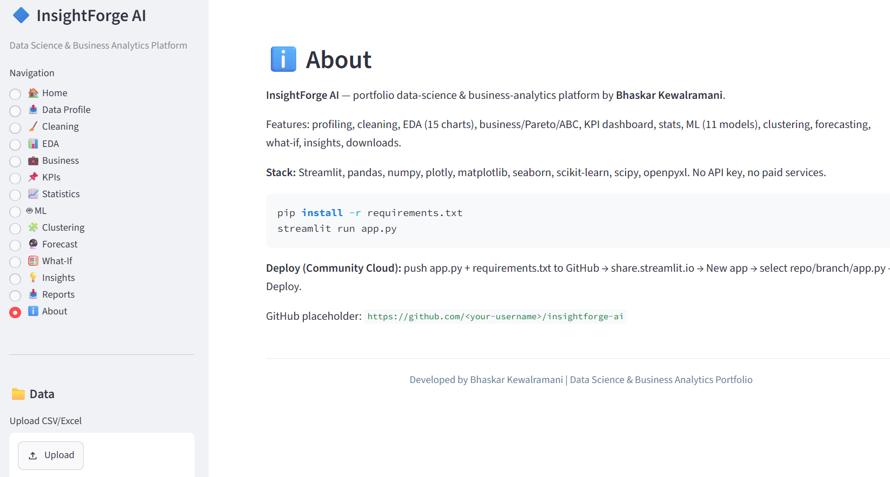
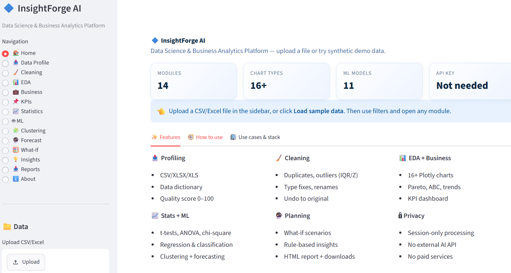

# Insightforge.AI
Data is the fuel to power apps.




### Planned files for GitHub repo `insightforge-ai`
1. `app.py` — already built (900+ lines, single-file Streamlit app)
2. `requirements.txt` — `streamlit, pandas, numpy, plotly, matplotlib, seaborn, scikit-learn, scipy, openpyxl`
3. `README.md` — draft below
4. Optional: `screenshots/` + `.streamlit/config.toml`


# 🔷 InsightForge AI – Data Science & Business Analytics Platform

> Upload any CSV/Excel → clean, explore, analyze, forecast, model, and download insights — no API key, no paid services.

**Developed by Bhaskar Kewalramani | Data Science & Business Analytics Portfolio**


---

## ✨ Live Demo
**Streamlit Community Cloud:** `https://<your-app>.streamlit.app` *(replace after deploy)*

## 🎯 What it does
General-purpose analytics app for business users, analysts & portfolio showcase:
Upload → Profile → Clean → EDA → Business/Pareto/ABC → KPI Dashboard → Stats → ML → Clustering → Forecasting → What-If → Auto Insights → HTML Report.

## 🚀 Features (14 modules)
- **🏠 Home:** intro, features, how-to, privacy note
- **📤 Data Profile:** CSV/XLSX/XLS, dictionary, types, describe, missing %, duplicates, quality score 0-100
- **🧹 Cleaning:** dedupe, drop/rename cols, trim/snake_case, fill NA (mean/median/mode/custom), IQR/Z outliers, datetime fix, Undo
- **📊 EDA:** Histogram, Box, Violin, Bar, Line, Area, Scatter, Bubble, Pie, Donut, Heatmap/Corr, Treemap, Sunburst, Funnel, Waterfall + scatter matrix
- **💼 Business:** KPI totals, Top/Bottom, Pareto, ABC, trend, Actual vs Target, segmentation, HHI concentration, rule-based observations
- **📌 KPI Dashboard:** cards, MoM delta, monthly trend, breakdown, contribution pie, management summary
- **📈 Statistics:** mean/median/mode/var/std/IQR/skew/kurt/CI, Shapiro, Pearson/Spearman, t-test, ANOVA, chi-square, linregress — plain-English H0/H1 + p-value
- **🤖 ML:** auto regression/classification detect + override, impute/scale/one-hot, 6 regressors + 5 classifiers, MAE/RMSE/R² / Acc/Prec/Rec/F1, confusion matrix, actual-vs-pred, best-model pick
- **🧩 Clustering:** K-Means, elbow, silhouette, PCA 2D, profiles
- **🔮 Forecasting:** D/W/M/Q/Y resample, MA, peaks/lows, linear-trend forecast + limitations
- **🧮 What-If:** base/optimistic/pessimistic/custom sliders, impact table + CSV
- **💡 Insights:** 8-12 rule-based insights with real values (no fake AI)
- **📥 Reports:** cleaned/filtered/quality/predictions CSV, summary/insights TXT, self-contained HTML report
- **ℹ️ About:** stack, local + cloud deploy guide

All calculations use **real uploaded data**. Synthetic demo data is clearly labelled.

## 🛠️ Tech Stack
`streamlit, pandas, numpy, plotly, matplotlib, seaborn, scikit-learn, scipy, openpyxl, io, datetime`

## 📦 Installation (local)
```bash
git clone https://github.com/<your-username>/insightforge-ai.git
cd insightforge-ai
pip install -r requirements.txt
streamlit run app.py
```
Open `http://localhost:8501`. If `python` not on PATH (Windows): `py -m streamlit run app.py`

**requirements.txt**
```
streamlit
pandas
numpy
plotly
matplotlib
seaborn
scikit-learn
scipy
openpyxl
```

## 🧭 How to use
1. Sidebar → Upload CSV/Excel **or** 🎲 Load sample data
2. Check Data Profile → Clean → apply sidebar filters
3. Walk EDA → Business → KPIs → Stats → ML → Forecast → What-If → Insights → Reports

**Sample data columns:** Date, Region, Product, Category, Customer_Segment, Quantity, Discount, Customer_Rating, Unit_Price, Sales, Cost, Profit, Target_Sales, Profit_Margin, Sales_Variance, Target_Achievement_Pct

## ☁️ Deploy to Streamlit Community Cloud
1. Push `app.py` + `requirements.txt` to GitHub
2. Go to share.streamlit.io → New app → select repo/branch/`app.py` → Deploy
3. No secrets / API keys needed

## 🔒 Privacy
In-memory session-only processing. No external AI API, no data leaving the session.

## 📁 Project Structure
```
insightforge-ai/
├── app.py
├── requirements.txt
├── README.md
└── screenshots/ (optional)
```

## 🗺️ Roadmap
- Seasonal decomposition (statsmodels optional)
- SHAP explainability
- PDF export
- Dark mode

## 🤝 Contributing
PRs welcome! Fork → feature branch → PR.

## 📄 License
MIT — free for portfolio & commercial use.

## 👤 Author
**Bhaskar Kewalramani** — Data Science & Business Analytics


*Developed by Bhaskar Kewalramani | Data Science & Business Analytics Portfolio*
```


